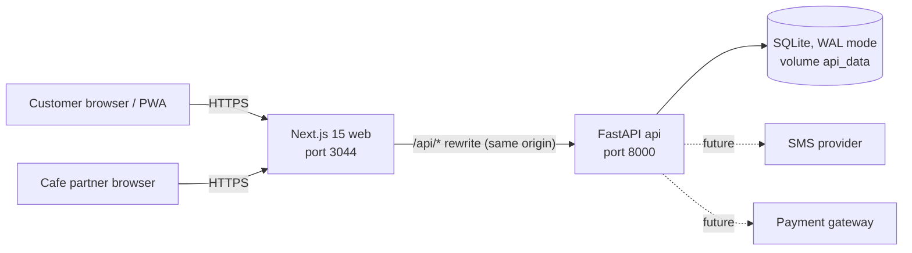
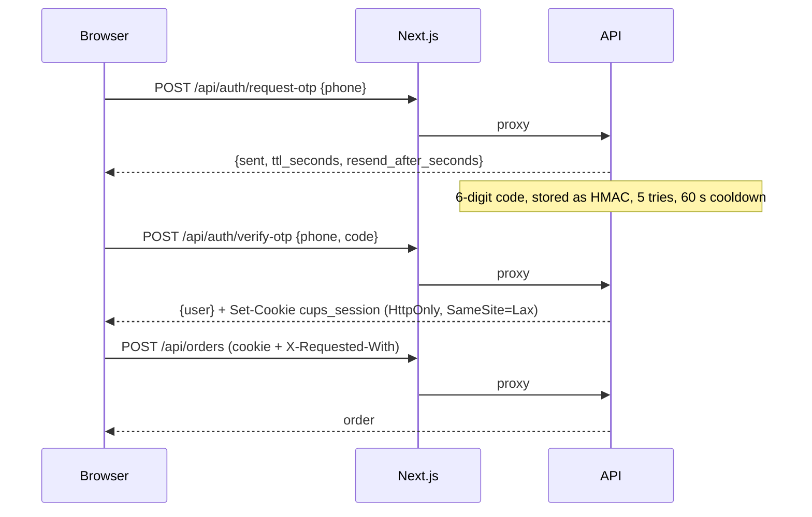
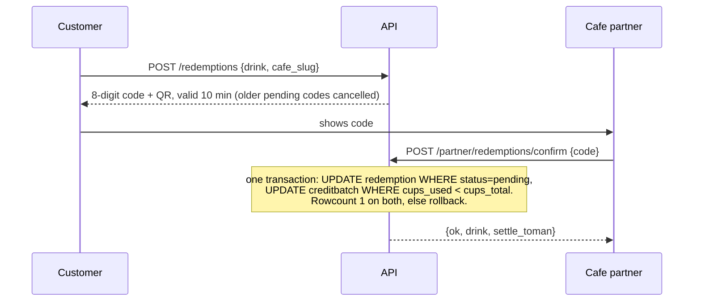
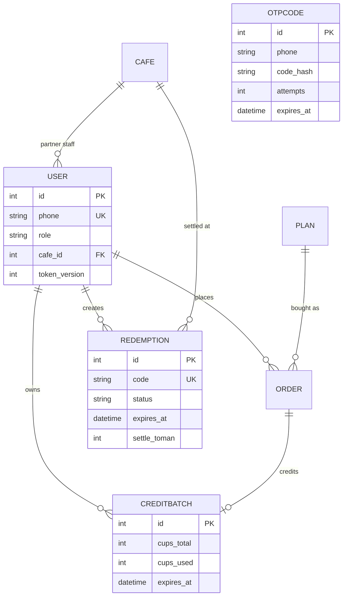

# Architecture

CUPS Iran (کاپ‌یار) sells prepaid coffee packs that customers redeem at independent cafes with a one-time code.

## System context

- The browser only talks to the Next.js origin. Next proxies `/api/*` to the API over the private compose network, so there is no CORS, no preflight, and no API address baked into the JavaScript.
- Dotted lines are integrations that do not exist yet. In `DEMO_MODE` the API returns the login code itself and credits orders instantly.

## Backend layout (`backend/app`)

| Module | Responsibility |
| --- | --- |
| `config.py` | Environment parsing and startup validation. Refuses weak or default secrets. |
| `db.py` | Engine, SQLite pragmas (WAL, busy timeout, foreign keys), `ensure_schema()` for in-place upgrades, indexes. |
| `models.py` | SQLModel tables. Naive-UTC datetimes through one `utcnow()` helper. |
| `auth.py` | JWT creation and verification, cookie or bearer extraction, token-version revocation, CSRF and Origin checks. |
| `ratelimit.py` | In-process sliding-window limiter and client IP resolution. |
| `middleware.py` | Security headers, cache headers, body-size limit, request id. |
| `observability.py`, `errors.py` | JSON logs, audit events with hashed phone numbers, uniform error body. |
| `jobs.py` | Background loop: expire overdue codes, purge old login codes, trim limiter state. |
| `routers/` | `auth`, `catalog`, `wallet`, `partner`. |
| `schemas.py` | Request models with length and pattern limits. |

## Frontend layout (`frontend/src`)

| Area | Responsibility |
| --- | --- |
| `app/[locale]/` | Pages for fa and en (home, plans, cafes, login, account, partner, privacy, terms). Server components fetch public data with a 60 s revalidate. |
| `components/` | UI building blocks. Client components only where interaction needs them. |
| `lib/api.ts`, `server.ts` | Same-origin API client and server-side data fetching. |
| `lib/useAuth.ts` | One `AuthProvider` for the whole app (a single `/api/auth/me` call). |
| `lib/safe-redirect.ts` | Allow-list for the post-login `next` parameter. |
| `middleware.ts` | Locale redirect and per-request CSP nonce. |
| `public/sw.js` | Service worker: static assets only, offline page, never caches HTML or API. |

## Login and session

## Redemption (the money path)

## Data model

## Deployment

`docker-compose.yml` runs two containers, both non-root, read-only root filesystem, all capabilities dropped, `no-new-privileges`, with memory and process limits. Ports bind to `127.0.0.1` by default. TLS terminates in a reverse proxy in front of the web container (not included); set `COOKIE_SECURE=1`, `ENABLE_HSTS=1` and `TRUSTED_PROXIES` accordingly. See `docs/devops-hardening.md`.

## Known limits (deliberate, with upgrade path)

- SQLite with one API process. Move to PostgreSQL and Redis (rate limiter) before running several workers.
- No SMS provider and no payment gateway yet. Production mode creates `pending` orders and credits nothing until a verified gateway callback exists.
- Settlement uses a fixed average cup price. A real menu-price model is a product decision.
